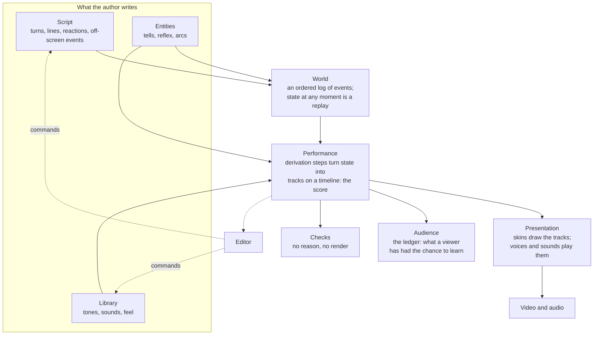

# Architecture

This is the target design. The code in this repository is the working prototype, restructured
enough to be a real project (a package, a command, tests, a file-format version) but not yet
rebuilt to this design. The section [From here to there](#from-here-to-there) says exactly
what exists and in what order the rest should be built.

Read [requirements-history.md](requirements-history.md) first: the design answers the
patterns and predictions in it.

## The idea in one paragraph

A show is a stack of four layers, each a pure function of the one below. The **script** is
what the author means. The **world** is everything that is true at each moment, built by
replaying events in order. The **performance** is everything an observer could see or hear,
as tracks on a timeline. The **presentation** turns those tracks into pixels and sound. The
editor and the checks read these layers; they never keep a second copy of the logic.



## Why layers, by the naive version

The prototype's `model.py` does all of it in one pass: it reads a turn, updates state,
resolves tells, plans speech, schedules reactions and emits keyframes. That was right for
finding out what the show is. It breaks in three ways that the history predicts will matter:

- **Changing how something looks touches the model.** The speech indicator needed a
  `voiced` duration added to the model's syllables. Presentation has churned in six rounds.
- **Adding a rule means editing the one big loop.** Appraisal belongs between "what was
  said" and "what is felt", which today is the middle of a 200-line function.
- **State is trapped inside a scene.** Carry-over works by replaying every earlier scene
  from scratch each time, and only two fields carry.

## The four layers

### 1. Script: what the author means

Plain files, as now. The rule for this layer is that **it records intent and overrides,
never results**. `say: Michael. Get in here.` is intent. Two bubbles is a result. A
`rhythm:` list is an override.

- **Schema.** Every file type has a published schema, and `show.yaml` carries a `schema:`
  number. The engine refuses a show written for a different one. (Exists: the number and the
  refusal. Not yet: the schemas themselves, and migration scripts.)
- **Migrations.** The format changed in most rounds: frames became steps, `cast` became
  `entities`, and a trigger key had to be renamed because YAML reads `on` as `true`. Each
  future change ships with a script that rewrites old files.
- **Units of meaning are things, not conventions.** Season, episode, scene, turn, beat,
  bubble, take. Today four of these are folders and keys, and three exist only inside the
  model. Each gets a type, so the next one is an addition.

### 2. World: what is true

**State is a replay of events.** Every change is an event with a time, a subject, a cause
and a reason: a turn made Otis feel shame; a day passed off-screen; an arc step changed how
Juno shows anger. The state at any moment is what you get by replaying events up to it.

A physical picture: the world is a ledger of deposits and withdrawals, not a balance someone
keeps overwriting. You can always ask what the balance was on any day, and why.

This one decision absorbs several features that are special cases today:

| Today | In the world layer |
|---|---|
| Carry-over between scenes: replay all earlier scenes, keep two fields | There is one log. A scene is a window onto it |
| Off-screen events: a block at the top of the next scene | Ordinary events that happen to have no screen time |
| Arcs: a list in the entity file, compared by scene path | Events that change an entity's tells |
| Felt state: one emotion per entity | A set of feelings, each with a start, a cause, and a rule for fading |

It also gives the next asks somewhere to live: **facts** and **who knows them** (appraisal,
and the audience's own knowledge), and state **between two entities** (relationships).

### 3. Performance: what could be seen and heard

The performance is **the score**: a set of tracks on the tempo grid. It is the contract
between everything above and everything below.

```
track                       holds
entity/otis/position        where it stands, over time
entity/otis/orientation     which way its body faces
entity/otis/attention       what it is attending to
entity/otis/posture         how it holds itself
entity/otis/voice           syllables: start, length, pitch, stress, text
stage/focus                 who holds the scene's attention
stage/bubbles               which words are showing, for whom
audio/events                things that make a sound, and how prominent
director/*                  felt, shown, weight: for x-ray and the ledger, never the audience
```

The score is produced by **derivation steps** run in order. Each step reads the world and
the score so far, and adds to it. The steps that exist in the prototype, in the order they
would run:

1. **Position**: sides and status give each entity a weight and a gain.
2. **Expression**: felt state, gain and an entity's tells give its observable channels.
3. **Speech**: a line gives syllables, stress, rhythm, melody and bubbles.
4. **Reaction**: reactions are placed on a word or given a beat; reflex delays them.
5. **Focus**: featured reactions take the scene's attention.

Three rules make this extensible:

- **A step is a plug-in.** Appraisal is a new step before Expression. Masking is a new step
  after it. A per-entity exception ("louder when outnumbered") is a variant of Position
  chosen in the entity's file.
- **Everything derived can be pinned.** If the script gives a value, the step leaves it
  alone. This is how `rhythm:` works now; it becomes the rule everywhere.
- **Everything derived says why.** Each value in the score records the step that made it and
  what it read. "Otis's eyes are down *because* shame 2, gain 0.67, first tell." The x-ray,
  the editor's hover text and the `why` discipline all read this instead of rebuilding it.

**Channels are declared, not hard-coded.** A channel has a name, a type, a resting value, a
way to blend between two values, and the tell keys that set it. Today adding one means
editing the model, the tells parser, the renderer and the editor. Declared once, a new
channel (gesture, level, held object, camera framing) is a declaration plus whatever each
skin chooses to do with it.

### 4. Presentation: pixels and sound

Presentation reads the score and nothing else.

- **A skin draws entities.** The token is one skin. The parked paper puppet is another. A
  skin is told an entity's channel values and draws them; a channel it does not understand
  it ignores. This is what makes "any entity" real: a robot vacuum and a person can share a
  score and differ only in skin.
- **A stage draws space.** Nine slots on a line is one stage. Depth or levels is another.
- **A voice plays syllables; a sound set plays events.** Synthesised today. Recorded samples
  and a backing track are other implementations on the same grid, and the score can be
  exported as MIDI for scoring elsewhere.
- **Camera is presentation driven by the score.** `stage/focus` already says who holds
  attention. A locked-off wide shot ignores it except to fade the others. A cutting camera
  reads the same track and chooses a framing. Neither changes the model.
- **Feel is presentation.** Settle time, overshoot, the indicator's size: all of
  `feel.yaml` belongs to a skin, not to the show's logic.

## Beside the layers

**Parameters are declared once.** Every tunable value has a name, a range, a unit, a
sentence of explanation and a scope (show, entity, scene, turn, syllable). The editor builds
its sliders, timeline handles and hover text from the declarations. This removes the
per-feature editor code and makes every change undoable in the same way.

**The editor is a client.** It sends commands ("set this turn's hold to 12") and receives a
score to display. It holds no logic about the show. Commands are the unit of undo, of
saving, and eventually of review.

**Checks are plug-ins with a severity.** "No reason", "no tell for this feeling", "this
payoff relies on something unlearned" are separate rules reading the same layers. An error
stops a render; a warning does not.

**The audience is a reader of the score.** The ledger reads `director/*` and `stage/focus`,
so it can know not only that a tell was shown but how prominently, and can later hold what
the audience knows about the story's facts.

**Everything is deterministic, so everything can be cached.** The same files give the same
score and the same frames. A scene's score is cached by a hash of what it read, which is
what lets a full series stay fast: today the prototype rebuilds every earlier scene to open
one.

**Time is musical.** One tempo grid per scene, counted in steps; durations are never frames
or seconds in the script. The frame rate is a rendering choice.

## Repository layout

Today, after the restructure:

```
toon/                 the engine (prototype modules: model, speech, draw, render, ledger, editor)
shows/demo/           a show: show.yaml, library/, entities/, episodes/<season>/<episode>/<scene>.yaml
tests/                34 tests of behaviour, each named for the rule it protects
docs/                 this design
```

The target, as the layers are pulled apart:

```
toon/script/          schemas, loading, migrations
toon/world/           events, replay, state queries
toon/perform/         the score, the channel registry, derivation steps (one file each)
toon/present/         skins, stages, voices, sound sets, the frame and audio renderers
toon/audience/        the ledger
toon/checks/          rules
toon/editor/          the server and the page
shows/<name>/         a show is data and can live in its own repository
```

The engine and a show are separate on purpose. The engine is reusable; a show is what you
are actually making.

## From here to there

Each step leaves the tests passing and the demo show rendering the same. The tests exist to
make this safe: they describe behaviour ("a pause separates bubbles"), not code.

| Step | What changes | Why this order |
|---|---|---|
| 0. Done | Package, `toon` command, show separated from engine, schema number, tests, CI | A base that can be changed without fear |
| 1 | **The score.** `model.py` writes tracks instead of keyframes; `draw.py` and the audio mix read only tracks | Everything else depends on this contract. Highest-value seam |
| 2 | **Skins.** The token becomes one skin behind an interface; `feel.yaml` moves under it | Presentation is what changes most; make it cheap first |
| 3 | **Derivation steps.** Split the turn loop into the five steps, with provenance | Opens the door to appraisal and masking |
| 4 | **Parameter and channel registries.** The editor is generated from them; all edits become commands | Removes the per-feature editor work |
| 5 | **The world as an event log.** Carry-over, off-screen and arcs become events; add caching | Needed before a series gets long, and before facts |
| 6 | **Schemas and migrations** for every file type | Before a second show or a second author exists |

Steps 1 to 3 are refactors with no change in behaviour. After step 3, the first new feature
(appraisal is the likeliest) is the test of whether the design holds.

## How the likely asks land

The measure of this design is that each predicted ask is an addition in one place.

| Ask | Where it goes | What else changes |
|---|---|---|
| Appraisal | A derivation step before Expression; facts in the world | A `says:` act on lines in the script |
| Camera and cutting | A presentation component reading `stage/focus` | A framing channel, if shots are to be scripted |
| Masking | A derivation step after Expression | Felt and shown already separate in `director/*` |
| Sets, props, richer bodies | Skins and a stage; a prop is an entity with no feelings | Nothing in the model |
| Backing track, samples, MIDI export | Voice and sound-set implementations; an exporter reading the score | Asset references in the library |
| Per-character exceptions | A named variant of a step, chosen in the entity file | Nothing else |
| Relationships | World state keyed by a pair | The Position step may read it |
| Background sightings count less | The ledger reads `stage/focus` | Nothing else |
| Feelings fade or mix | The felt-state type in the world | Expression blends more than one |
| A stage with depth | A stage implementation; position becomes a richer channel type | Skins that care about depth |
