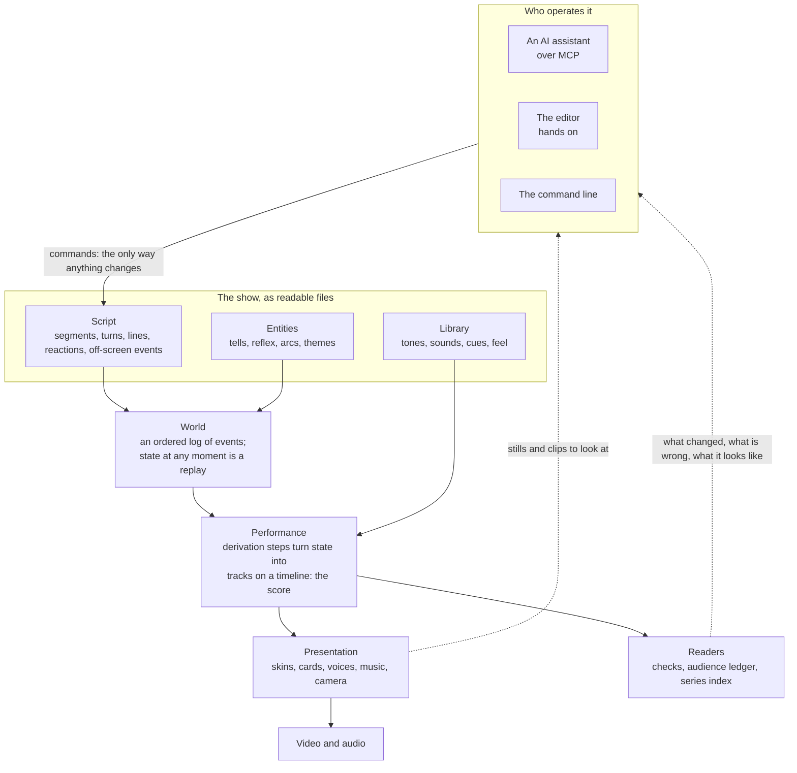

# Architecture

This is the design the code is built to. Most of it exists; the section
[What exists](#what-exists) says which parts do, and [phases.md](phases.md) says in what order
they were built. Where this document describes something not yet built (the series index, the
MCP server, skins), it says so there.

Read [how-it-is-used.md](how-it-is-used.md) first: it describes the two loops this design
has to serve. Then [requirements-history.md](requirements-history.md): the design answers the
patterns and predictions in it, and was revised once already when four new requirements
arrived (title screens, music scoring, series tracking, and AI as the main way of working).

## The idea in one paragraph

The tool contains no AI. A writer talks to an assistant such as Claude, and the assistant
operates the tool through its command line (and, much later, an MCP server offering the same
commands). The writer's own hands touch the tool for one thing: nudging a value and replaying
to see if it feels right. Either way, what it sends are **commands**, the only way anything changes. Commands edit the **script**, which is what the author means. From the
script the engine computes the **world** (everything true at each moment), then the
**performance** (everything that could be seen or heard, as tracks on a timeline), then the
**presentation** (pixels and sound). Readers such as the checks, the audience ledger and the
series index look at those layers and report back to whoever is operating: the AI, the
editor, or a script. No operator holds any of the show's logic.



## Why this shape, by the naive version

The prototype's `model.py` does everything in one pass, and every change to a show so far
was made by an AI hand-editing YAML. That was right for finding out what the show is. It
breaks in four ways:

- **Changing how something looks touches the model.** Presentation changed in six rounds.
- **Adding a rule means editing one big loop.** Appraisal and music scoring both belong in
  the middle of it.
- **State is trapped inside a scene.** Opening one scene replays every scene before it.
- **Hand-edited files fail silently.** A reaction keyed `on:` was read by YAML as `true` and
  did nothing. A writer who works through an assistant never sees the file, so a
  silent failure is invisible to everyone.

## Operating it: commands, and AI first

**Everything that can be done to a show is a command.** `add_turn`, `set_line`,
`set_feeling`, `add_reaction`, `set_timing`, `define_entity`, `set_tell`,
`add_offscreen_event`, `place_cue`, and so on. A command is typed, validated before it is
applied, undoable, and recorded with who asked for it and in what words.

There are three ways in, and they are equals in what they can do:

| Way in | Used by | For |
|---|---|---|
| **The command line**, `s2s ...` | An assistant working in a terminal; scripts; a person | Everything |
| **The editor** | The writer, by hand | Tuning only: nudge a value, replay, compare. It never changes words, feelings or structure |
| **The MCP server**, `s2s mcp` (later) | An assistant that is not at a terminal | The same commands, plus reading the show as resources |

The command line comes first and is enough on its own. The MCP server is the end state: when
it is built it is generated from the same list of commands, so it cannot do something the
command line cannot, or fall behind it.

**What makes the command line good for an assistant.** An assistant uses a command line the
way a careful stranger would: it reads the help, runs something, and reads what comes back.
So:

| Property | Meaning |
|---|---|
| It describes itself | `s2s help`, `s2s help <command>` and `s2s commands --json` list every command, its arguments and an example. Nothing has to be known in advance |
| Every command can answer in JSON | `--json` gives the same result a person sees, as data |
| It never asks a question | No prompts and no confirmations. A command runs or refuses |
| It can be rehearsed | `--dry-run` reports exactly what would change and what would then be wrong, and changes nothing |
| A refusal says what to do | "No word 'dumplings' in this line. Its words are: someone, ate, the, last, dumpling." |
| Things have short, stable addresses | `s01/e01/vase:3` is turn 3 of that scene, wherever the file is |
| Results are files at stated paths | A render prints where the clip or still went |
| Exit codes mean something | Success, refused, and check-failed are different numbers |

**Why commands and not file edits, for the AI in particular.** An assistant that edits text
can produce a file that parses and means nothing. An assistant that calls `add_reaction(who,
word, feeling)` cannot misspell a key, and gets back a precise refusal if the word is not in
the line. The files stay readable and hand-editable (decision 11), but nobody has to.

**What the MCP server will expose, when it is built.** MCP has three kinds of thing, and each
has a job here:

| Kind | Contents | Why |
|---|---|---|
| **Resources** (things to read) | The series index, each script, each entity sheet, the resolved state at any point, the ledger, current problems, the schemas, and the registries of channels and parameters | The assistant learns the show and the engine's vocabulary by reading, so a new channel or parameter is usable the day it is declared |
| **Tools** (things to do) | Every command; `check`; `explain` (why is this value what it is); `render_still`, `render_contact_sheet`, `render_clip`; `compare` | Doing, verifying and looking are all first-class |
| **Prompts** (ways of working) | Draft a scene from a description; stage a scene I know; apply these notes; tighten the pacing; propose a title sequence | The house method, shipped with the tool |

**The loop the writer experiences.** The conversation is between the writer and their
assistant. The tool is what the assistant reaches for.

1. The writer tells the assistant: *"In the vase scene, Otis should seem more defensive, and
   let the silence after 'I saw' run longer."*
2. The assistant reads the scene and Otis's sheet, and runs `explain` to see why he
   currently looks down and goes quiet.
3. It rehearses a **change set** with `--dry-run`: raise his shame from 2 to 3 on that line;
   lengthen the hold after "I saw" from 8 steps to 14. Each change carries a reason, because
   every turn must.
4. The tool reports what would then be wrong. If the ledger objects (a payoff resting on an
   unlearned tell), the assistant revises before the writer is bothered.
5. The assistant applies the changes, renders stills, looks at them, and shows the writer a
   clip.
6. The writer says yes, no, or something else. Anything applied can be undone; the editor,
   if open, updates live.

Three properties make that loop trustworthy:

- **Every response says what changed, what is now wrong, and how to see it.** The assistant
  can correct itself without the author.
- **Changes can be rehearsed, grouped and undone.** How much the assistant shows the writer
  before applying is between the two of them; the tool makes either choice safe.
- **Provenance is kept.** Each change records the author's own words that caused it. "Why is
  this hold 14?" has an answer a year later.

**No AI lives inside the tool.** It is deterministic, has no model and calls no AI service.
The MCP "prompts" above are text the tool hands to an assistant, not something it runs. Any
assistant can operate it, which also means it can be tested without one.

## The four layers

### 1. Script: what the author means

Plain files. The rule for this layer is that **it records intent and overrides, never
results**. `say: Michael. Get in here.` is intent. Two bubbles is a result. A `rhythm:` list
is an override.

- **An episode is an ordered list of segments, declared in a manifest.** A scene is one kind
  of segment. A **title card** is another. Recaps, cold opens and credits are others when
  wanted. The manifest gives each segment an order, a title and a status. (Today an episode
  is a folder of scenes read in filename order, and a scene is the only kind.)
- **Seasons, episodes and segments carry descriptions**: title, logline, status (idea,
  drafted, staged, locked), tags. This is what the series index is built on.
- **Things have stable identities.** An arc that starts "from scene X" must survive X being
  renamed or moved. Identity is an ID in the file, not its path.
- **Schema and migrations.** Every file type has a published schema, and `show.yaml` carries
  a `schema:` number. The engine refuses a show written for a different one, and every format
  change ships with a script that rewrites old files. (Exists: the number and the refusal.)

### 2. World: what is true

**State is a replay of events.** Every change is an event with a time, a subject, a cause
and a reason: a turn made Otis feel shame; a day passed off-screen; an arc step changed how
Juno shows anger. The state at any moment is what you get by replaying events up to it.

A physical picture: the world is a ledger of deposits and withdrawals, not a balance someone
keeps overwriting. You can always ask what the balance was on any day, and why.

| Today | In the world layer |
|---|---|
| Carry-over between scenes: replay all earlier scenes, keep two fields | There is one log. A segment is a window onto it |
| Off-screen events: a block at the top of the next scene | Ordinary events that happen to have no screen time |
| Arcs: a list in the entity file, compared by scene path | Events that change an entity's tells |
| Felt state: one emotion per entity | A set of feelings, each with a start, a cause, and a rule for fading |

It also gives later asks somewhere to live: **facts** and **who knows them** (appraisal, and
what the audience knows), and state **between two entities** (relationships).

### 3. Performance: what could be seen and heard

The performance is **the score**: a set of tracks on the tempo grid. It is the contract
between everything above and everything below.

```
track                       holds
entity/otis/position        where it stands, over time
entity/otis/orientation     which way its body faces
entity/otis/attention       what it is attending to
entity/otis/posture         how it holds itself
entity/otis/voice           syllables: start, length, pitch, stress, text
stage/focus                 who holds the scene's attention
stage/bubbles               which words are showing, for whom
stage/card                  a title or other full-frame card: its text and timing
drama/events                what just happened, dramatically (see below)
audio/music                 cues: beds, stingers, themes
audio/events                things that make a sound, and how prominent
director/*                  felt, shown, weight: for x-ray and readers, never the audience
```

The score is produced by **derivation steps** run in order. Each reads the world and the
score so far, and adds to it.

1. **Position**: sides and status give each entity a weight and a gain.
2. **Expression**: felt state, gain and an entity's tells give its observable channels.
3. **Speech**: a line gives syllables, stress, rhythm, melody and bubbles.
4. **Reaction**: reactions are placed on a word or given a beat; reflex delays them.
5. **Focus**: featured reactions take the scene's attention.
6. **Drama**: names what happened, for the steps and readers that care.
7. **Scoring**: turns dramatic events into music cues.

Steps 1 to 5 exist in the prototype as one loop. Steps 6 and 7 are new.

Three rules make this extensible:

- **A step is a plug-in.** Appraisal is a new step before Expression. Masking is a new step
  after it.
- **Everything derived can be pinned.** If the script gives a value, the step leaves it
  alone. This is how `rhythm:` works now; it becomes the rule everywhere, including for
  music: a cue the author places by hand is kept, and a cue the author forbids stays out.
- **Everything derived says why.** Each value records the step that made it and what it
  read. The x-ray, the editor's hover text and the assistant's `explain` tool all read this.

**Channels are declared, not hard-coded.** A channel has a name, a type, a resting value, a
way to blend between two values, and the tell keys that set it. A new channel is a
declaration plus whatever each skin chooses to do with it.

#### Dramatic events, and why music needs them

The naive way to score a scene is to place every cue by hand. It breaks the same way
hand-written poses did: the score for "something bad and unexpected" would be decided afresh
each time and drift.

So the engine first says **what happened**, then decides what it sounds like.

A dramatic event has a kind, a subject, and a few dimensions:

| Dimension | Meaning | Example |
|---|---|---|
| Valence | Good or bad, and for whom | Otis is caught: bad for him |
| Expectedness | Did the audience see it coming | The ledger knows what has been set up |
| Weight | How much it matters | Intensity, and whether it was featured |

"Surprising and bad" and "surprising and good" are then two points in that space, and the
**Scoring** step maps regions of the space to cues from `library/cues.yaml`. This needs two
things the prototype lacks: emotions that declare a valence (today they are a flat list with
a colour each), and a reading of expectedness, which the audience ledger is already placed
to supply.

The same events serve other consumers: a cutting camera wants to know that a reveal just
landed, and the series index wants to count them.

Music itself sits on the grid the voices already use:

| Layer | What it is | Driven by |
|---|---|---|
| Bed | Underscore for a stretch of scene | The scene's prevailing state, or the author |
| Stinger | A short figure on an event | Dramatic events |
| Theme | A motif belonging to an entity, a place or an idea | The entity's file; quoted by beds and stingers |
| Silence | The deliberate absence of all of it | A featured beat, or the author |

Cues are written as notes in the show's scale and tempo, so they agree with the speaking
voices, and can be exported as MIDI to be re-recorded properly elsewhere.

### 4. Presentation: pixels and sound

Presentation reads the score and nothing else.

- **A skin draws entities.** The token is one skin; the parked paper puppet is another. A
  channel a skin does not understand, it ignores.
- **A stage draws space.** Nine slots on a line is one stage. Depth or levels is another.
- **A card draws a full-frame segment.** A title screen is a card with typography, timing
  and a cue. It reads `stage/card` and uses no entities at all.
- **A voice plays syllables; a sound set plays events; an instrument set plays music.**
  Synthesised today. Recorded samples are other implementations on the same grid.
- **Camera is presentation driven by the score.** `stage/focus` and `drama/events` say where
  attention is. A locked-off wide shot ignores them except to fade the others. A cutting
  camera reads the same tracks and chooses a framing.
- **Feel is presentation.** All of `feel.yaml` belongs to a skin, not to the show's logic.

## Object shows: what was added, and where it lives

A show whose cast are objects (seals, matches, padlocks) with no faces, held in wide shots, uses the same four layers. What it added:

| What | Where | Driven by |
|---|---|---|
| Object bodies, outfits and per-character variations; an `Inked` canvas that draws a line round every solid shape | `presentation/bodies.py` | the entity sheet: `body`, `outfit`, `climbs`, ... |
| A room's light, cast shadows, raised bench, drawn outlines, open arches and sky | `presentation/place.py` (the room), `presentation/draw.py` (`seat`, `light`, `swell`, `bench_front`, `fireball`) | the place file: `light`, `shadow`, `ink`, `bench`, `sky` |
| The land: the title sequence over it, and travel between scenes by way of it | `presentation/land.py` (`Land`, `Travel`) | `land.yaml` (`places`, `history`, `camera`), each scene's `day:` in series.yaml, each place's `land:`. A title sequence between two scenes plays the days between them: the land changes as `history` says (`ruin`, `ring`, `reach`, `flags`, each gradual with `over:`), under a sun and moon; the travel card after it only comes down |
| The anthem and the bed that plays under travel | `presentation/anthem.py` | `library/music.yaml: theme: anthem` |
| Rendering an episode part by part | `presentation/episode.py` | see below |
| Looking at an episode without rendering it | `presentation/readings.py` | `s2s moments`, `shots`, `listen`, `rhythm`, `frames`, `beats` |
| Sounds placed by hand, with a length, a level and fades; a level curve per layer; a room's quiet bed | `presentation/sound.py` (`blast`, `swell`, `air`, `faded`, `bent`, `mix`) | a turn's `sfx:`, a scene's `levels:`, `library/sounds.yaml`, a place's `air:` |
| Hand-set values on a card: its length, where its music lands, its level and fades | `presentation/episode.py` (`parts`) | `tune:` and `levels:` on the segment in series.yaml |
| Notes pinned to moments | `commands/notes.py` | the show's `notes.yaml`; `s2s notes` |

**How an episode is rendered.** Each part (a scene or a card) becomes a film of its own, as many at once as the machine has
processors, and the parts are joined without encoding again. A part is stamped with everything it is made from (the engine, the
show's files, its own script); if the stamp matches a film already in `out/.parts/`, that film is kept. So a change to one scene
costs one scene. A room is painted once per camera position and kept as a picture, because nothing in a room moves.

**The grid.** A show has one tempo. A bar is `steps_per_beat x beats_per_bar` steps and a phrase is eight bars. A turn can ask
to land on a bar (`bar: 24`: a speaking turn's line starts there) and a scene to be so many bars long (`bars: 32`); whatever
comes before waits the difference, and a beat that cannot land is an error. A come-up is always two bars (`blast` swells for two
bars first; `swell` is the come-up alone). Cards are whole bars too, so every part starts on the beat.

**Looking without rendering.** `s2s moments` (a contact sheet at chosen seconds), `s2s shots` (every camera shot and why),
`s2s listen` (a picture of the sound, and what is wrong with it), `s2s rhythm` (the episode as a song: bars, rise and fall),
`s2s beats` (where every turn lands on the grid; `s2s retime` moves several at once), `s2s render --draft` and `--only`.

**The editor and the episode.** The editor opens one part at a time: a scene, or a card. A card is given to the timeline in a
scene's shape (one turn as long as the card, its music as a placed sound), so the same page serves both; the whole episode is
one more such part, its parts end to end with the episode's own soundtrack. Everything the editor changes it writes as a
hand-set value where the thing lives: a `tune:` block on a turn, on a segment, or in the library; `levels:` on a scene or a
segment; the camera's stops in `land.yaml`. A change made from outside while the editor is open (the assistant, with a
command and its reason) is read from the journal and shown: a caption, the playhead on the moment, the knob on the value.

**Keys are declared once.** `vocabulary/keys.py` lists every key a show's files may use; the engine reads nothing else, and
`s2s check` warns about anything else. **The look is kept.** `s2s frames` compares an episode with its kept frames
(`frames/<episode>.png`); see `docs/tech-debt.md` for what is still owed.

**Frames are repeatable.** The same frame is the same pixels on every run and in every process; nothing depends on the order
frames are drawn in or on anything random per run. Tests and the part stamps rely on this.

## Readers

A reader looks at the layers and reports. It changes nothing.

**Checks** are plug-ins with a severity. An error stops a render; a warning does not.

**The audience ledger** tracks what a viewer has had the chance to learn, including how
prominently, and supplies "expectedness" to the Drama step.

**The series index** is how the show is tracked and compared. For every season, episode and
segment it holds the description from the manifest plus measurements taken from the score:

| Measured | Lets you see |
|---|---|
| Length, number of turns, words per entity | Pacing, and who dominates |
| Each entity's state on entering and leaving | Arcs across the series, as a line you can follow |
| Sides and weights | Who was outnumbered where |
| Tells shown; dramatic events by kind | What each episode actually delivers |
| Music cues used | Whether a theme is overworked |
| Status and last change | What is finished |

From it come three views: a **map** of the whole series, a **thread** following one entity
or one idea across it, and a **comparison** of any two units side by side, with their clips.
The index is also the first thing an assistant reads, so the same structure serves the
author's overview and the AI's context.

The index is cheap because of the next point.

## Underneath

**Everything is deterministic, so everything can be cached.** The same files give the same
score and the same frames. Each segment's score is cached by a hash of what it read. That is
what makes a series-wide index and comparison affordable.

**Parameters are declared once.** Every tunable value has a name, a range, a unit, a
sentence of explanation and a scope. The editor builds its controls from the declarations,
and the MCP server publishes them, so hands and AI see the same knobs.

**Time is musical.** One tempo grid per segment, counted in steps. The frame rate is a
rendering choice.

## Repository layout

```
script_to_screen/
  vocabulary/     params.py (every tunable value), channels.py (everything observable), keys.py (every key a file may use)
  script/         loading a show's files, series.yaml, hand-set values (tuning.py)
  world/          what is true at each moment, as a log of changes and their causes
  performance/    scene.py plays a scene on the grid and ends in a score (score.py); the steps it runs: speech, expression,
                  appraisal, standing, tendencies, placing, drama, scoring, camera
  presentation/   draw.py, bodies.py, place.py, motion.py (a frame); sound.py, music.py, anthem.py, master.py (the mix);
                  cards.py, land.py (titles, credits, the land); episode.py (one film from its parts); readings.py (looking
                  without rendering); stage.py, view.py, render.py, framecache.py
  readers/        ledger.py, inplay.py, parity.py, story.py, branches.py, whatif.py
  commands/       every command, declared once: read.py, change.py, structure.py, tune.py, look.py, notes.py; edit.py is the
                  journal and undo; address.py turns "thermostat:2+6" into a place
  tools/          editor.py (a local server) and editor.html (the page)
  cli.py          the command line, generated from the commands
shows/<name>/     a show is data: show.yaml, series.yaml, library/, entities/, places/, episodes/, and (optionally) land.yaml,
                  notes.yaml, frames/ (kept frames), reference/ (parity references). .s2s/ holds the journal and takes; out/ the films
tests/            what the engine promises, each test named for the rule it protects
docs/             this design, the decisions, the phases, and the running lists
```

Layers only import downward (a test enforces it): vocabulary, script, world, performance, presentation, readers, commands, tools.

## What exists

| Part of the design | State |
|---|---|
| Commands and the command line; dry runs, undo, a journal with the writer's words | Built. Entity sheets' written values and tells are still edited as files |
| The tuning loop: the editor follows the files, nothing is ever unsaved, replay, before and after, loop, the knob at every scope | Built |
| Identities and series.yaml; segments of kind scene and card | Built |
| The score as the contract between performance and presentation | Built |
| Registries: parameters, channels, and the keys of turns, places, land and sheets | Built. Keys of scenes and of series.yaml are not declared yet |
| Derivation steps: speech, expression, appraisal, standing, tendencies, placing, drama, scoring, camera | Built as modules run in a fixed order; not yet replaceable per entity |
| Cards, the land, an episode as one film rendered part by part | Built |
| The world as an event log | Built; replay is not cached across a long series |
| Schemas and migrations | A schema number and `s2s migrate` (1 to 2) |
| Skins (a body as a skin over abstract channels) | Bodies are chosen by the entity sheet (`body:`), drawn in `bodies.py`; there is no separate skin registry |
| The series index: a map, a thread, a comparison | Not built. `s2s list` and the ledger are what there is |
| The MCP server | Not built. Nothing waits for it |

## How the asks land

The measure of this design is that each ask is an addition in one place.

| Ask | Where it goes | What else changes |
|---|---|---|
| Title screens | A segment kind in the manifest; a card in presentation | A `stage/card` track |
| Music scoring | The Drama and Scoring steps; `library/cues.yaml` | Emotions declare a valence; themes in entity files |
| Tracking and comparing | The series index, a reader | Manifests and stable identities |
| A writer works through an assistant | The command layer, with the command line and MCP server over it | Nothing in the model |
| Appraisal | A step before Expression; facts in the world | A `says:` act on lines |
| Camera and cutting | A presentation component reading focus and drama | A framing channel, if shots are scripted |
| Masking | A step after Expression | Felt and shown already separate |
| Sets, props, richer bodies | Skins and a stage; a prop is an entity with no feelings | Nothing in the model |
| Per-character exceptions | A named variant of a step, chosen in the entity file | Nothing else |
| Relationships | World state keyed by a pair | The Position step may read it |
| Feelings fade or mix | The felt-state type in the world | Expression blends more than one |
