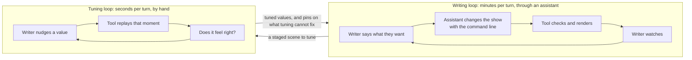

# How it is used

The architecture describes the tool from the inside. This document describes it from the
writer's chair, and it comes first: a design that serves the internals and not the two ways
the writer actually works is the wrong design.

## The goal

Make an animated series in which every detail is deliberate and consistent across episodes.
The writer supplies intent and taste. An assistant does the construction. The tool keeps the
show consistent and makes its feel adjustable by hand.

## Two loops

The writer never builds anything in the tool. They do two different things, at two
different speeds, and each needs different things from the tool.

| | Writing loop | Tuning loop |
|---|---|---|
| Who touches the tool | The assistant | The writer |
| Through | The command line (an MCP server, much later) | The editor |
| What changes | Meaning: scenes, lines, feelings, characters' rules, structure | Feel: timings, pitch, stress, motion, sound |
| The unit | A scene or a turn | One value at one moment |
| Speed | Minutes | Seconds, dozens of times in a row |
| How it is judged | Is this the scene I meant? | Does this match my feeling? |
| The tool must be | Complete, explicit, and safe to operate blind | Instant, and exactly what the final video will be |

The writer's only direct contact with the tool is the tuning loop: change a value, replay,
feel. Everything else reaches the tool through the assistant.

## What the writing loop needs

The assistant is a careful stranger with a terminal. It needs to be able to:

| Need | So that |
|---|---|
| **Read** the show: scripts, entity sheets, resolved state at any moment | It knows what exists before changing it |
| **Change** anything with a typed command, and rehearse the change first | A mistake is refused, never silently accepted |
| **Check**, and be told precisely what is wrong and what would fix it | It corrects itself before showing the writer |
| **Explain** any value: why is his head down here? | It can answer the writer's "why", and find the right thing to change |
| **Look**: stills and contact sheets at chosen moments | It can see what it made, as the writer will |
| **Render** a clip for the writer | The writer watches a result, not a description |
| **Point**: short, stable addresses for a scene, a turn, a moment | "The pause after 'I saw'" can be turned into a place |
| **See what the writer did by hand** since it last looked | It builds on tuning and never undoes it |

All of this is the command line. An MCP server offers the same commands to an assistant that
is not at a terminal; it is the end state and nothing depends on it.

## What the tuning loop needs

Tuning is perceptual. The writer is not reasoning; they are comparing a feeling to what they
see and hear, over and over. Anything that interrupts that comparison breaks the loop.

| Need | So that |
|---|---|
| **Replay at once**: change a value and the affected moment plays again, with sound | The feeling being checked is still in mind |
| **Replay what matters**: this line, this turn, this stretch, on a loop | Attention stays on one thing |
| **Before and after**: flip between the old value and the new one | "Better" is a comparison, and memory is unreliable |
| **Undo anything**, the same way | Trying a value costs nothing |
| **The real thing**: replay is the final renderer and the final sound | A tweak that felt right still feels right in the episode |
| **Every tunable value is reachable** | No value needs a round trip to the assistant just to be nudged |
| **Scope is visible**: is this value for this moment, this character, this tone, or the whole show? | A nudge does not quietly change forty other scenes, and a discovery can be promoted on purpose |
| **A pin**: mark a moment that tuning cannot fix, with a few words | The problem goes back to the writing loop attached to a place |

What the tuning loop must **not** do is grow into authoring. The editor does not change
words, feelings, structure or characters' rules. It may show them, because knowing why
something happens helps judge whether it feels right.

## Where the loops meet

The loops alternate on the same scene, and the hand-offs are where work gets lost.

**From writing to tuning.** The assistant finishes a pass and names the place. The editor
opens there, and shows what changed since the writer last looked.

**From tuning to writing.** The writer's saved values and pins are there for the assistant
to read. A pin says "this beat doesn't land" at a moment; the assistant treats it as a note.

**Three rules protect each loop from the other:**

1. **Every value remembers who set it**: derived by the engine, set by the assistant, or
   tuned by hand. Hand-tuned values outrank the rest.
2. **A change that would discard hand-tuned values says so first.** Rewriting a line drops
   the rhythm tuned for its old syllables. The assistant sees "this discards 7 hand-tuned
   values" when it rehearses the change, and can tell the writer before doing it.
3. **A unit can be locked.** Once a scene is tuned and the writer is satisfied, it is marked
   locked, and commands refuse to change it until it is unlocked.

And one rule lets the loops work on the show at the same time:

4. **The editor follows the files.** If the assistant changes a scene while the editor is
   open, the editor reloads it. If both changed the same scene, values are merged one by one
   and a conflict is shown, never silently resolved.

**Tuning feeds writing.** If the writer lengthens the hold after every accusation, that is a
rule waiting to be written. The assistant can list every hand-tuned value beside what the
engine would have chosen, notice the pattern, and propose making it the default. This is the
project's oldest habit, hand-set values becoming derived ones, turned into a routine.

## What exists, and what does not

| Need | Today |
|---|---|
| **Writing loop** | |
| Read, change, rehearse, explain through commands | Mostly. Scenes are read, explained and changed by command, with dry runs and undo. Entity sheets, the library and show settings are still edited as files |
| Check with precise messages | Mostly. A refused command says what would work; check messages name the turn but not always the fix |
| Look at stills | Yes. `still` and `sheet` |
| Stable addresses | Yes for scenes: `scene:turn`, by an id that survives renaming and moving. A turn is still named by its `id` or number |
| See what the writer did by hand | No |
| **Tuning loop** | |
| Replay at once after a change | Partly. Changing a note replays its line. Moving a slider discards every frame of the scene and waits |
| Loop a stretch | Partly. One turn can be looped; not a line or a chosen stretch |
| Before and after | No |
| Undo anything | Partly. Timings and notes; not sliders |
| The real thing | Yes. The editor draws with the renderer and plays the same sound |
| Every tunable value reachable | Partly. Timings, notes, stress, motion and sounds are. A tone's rate and contour, and a character's voice and reflex, are not |
| Scope is visible | No. Sliders are silently show-wide; timings are silently per turn |
| A pin | No |
| **Where they meet** | |
| Who set each value | No |
| Warning before discarding tuned values | Partly, by accident: a rhythm that no longer fits its line is an error |
| Locking | Yes. `set-status <scene> locked`; every change command then refuses |
| Editor follows the files | **No. The editor keeps its own copy and overwrites the file on save.** |

The entry in bold is the one that can lose work today.
